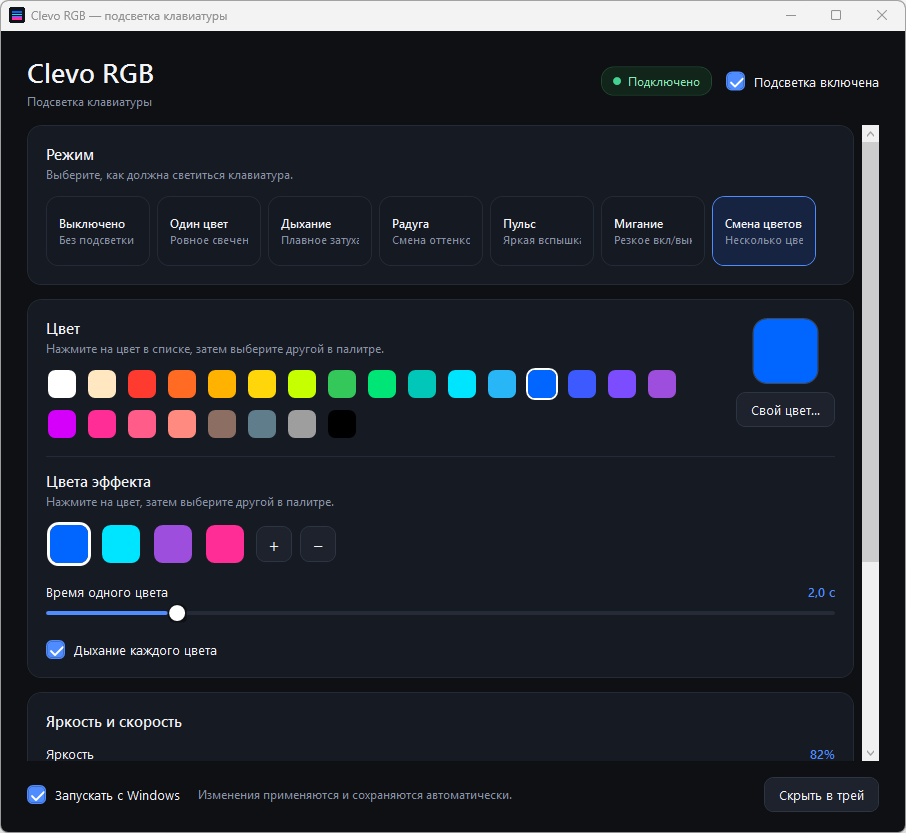
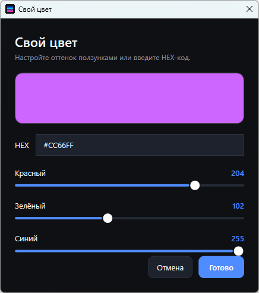

# Clevo RGB

**English** · [Русский](README.ru.md)

A small, open-source Windows app for the RGB backlight on Clevo / Thunderobot laptops.

[](https://github.com/volodivianix09/clevo-rgb/releases)
[](https://dotnet.microsoft.com/)
[](LICENSE)



The vendor Control Center gives you a few preset colors and a brightness slider. This app gives you the full palette and effects that actually fade smoothly — breathing, rainbow, pulse, blink, and multi-color sequences.

No administrator rights. No Windows service. No telemetry. No network calls.

## Why this exists

On many Clevo-based laptops the keyboard is controlled by `InsydeDCHU.dll` from Control Center. The controller only accepts a static color at a time, so all animation has to be generated by software. This app does exactly that: it sends a new color about 25 times per second and creates smooth transitions on top of a controller that only knows how to show one color.

That is also why the app can do things the vendor UI cannot: custom sequences, long fades, adjustable breathing speed, and any color you want.

## Features

- **7 lighting modes:** Off, Static, Breathing, Rainbow, Pulse, Blink, Color sequence
- **24-color palette** plus a custom color picker with RGB sliders and HEX input
- **Color sequence editor** — up to 6 colors, adjustable hold time, breathing or cross-fade
- **Brightness and speed** controls
- **Live preview** — changes apply immediately and are saved automatically
- **Tray icon** — close the window and the lighting keeps running
- **Autostart with Windows** — one checkbox
- **Single instance** — launching it again just opens the existing window
- **No admin rights** and **no background service**
- **Russian UI** (English README included for GitHub visitors)

## Supported laptops

> **Important:** this app controls a **single lighting zone**. All keys show the same color and brightness at the same time. Per-key RGB, 3-zone keyboards and lightbars use different controllers and are not supported.

| Laptop / barebone | Status | Notes |
|---|---|---|
| **THUNDEROBOT 911 Plus** (Clevo **NH79HX-H**, i5-11400H, Windows 11) | ✅ **Tested** | The machine this project was built and tested on |
| Clevo **NH79HX / NH7xHX** family | 🟡 Likely | Same Control Center 3.0 / DCHU stack; please test |
| Clevo **P955ET1** and similar single-zone models | 🟡 Likely | Uses the same `InsydeDCHU.dll` color protocol |
| Tongfang / other Clevo resellers with the same DCHU driver | 🟡 Likely | Check the compatibility test below |
| Per-key RGB, 3-zone or lightbar-only models | ❌ Not supported | Different protocol/controller |
| Lenovo, ASUS, Acer, HP, MSI, Dell, etc. | ❌ Not supported | Different EC / vendor SDK |

**Quick compatibility check.** Open PowerShell and run:

```powershell
Test-Path "${env:ProgramFiles(x86)}\ControlCenter\DCHU\InsydeDCHU.dll"
```

If it returns `True`, there is a good chance the app will work. Run it and look at the status in the top-right corner: **Подключено** means the driver was found and the first color write succeeded.

More details: [docs/SUPPORTED-LAPTOPS.md](docs/SUPPORTED-LAPTOPS.md)

## Install

### Ready-to-run build

1. Download `ClevoRGB-1.0.0-win-x64.zip` from [Releases](https://github.com/volodivianix09/clevo-rgb/releases).
2. Extract it anywhere — no installer is needed.
3. Run `ClevoRgbLite.exe`.

Requirements:

- Windows 10 or 11, x64
- **Control Center 3.0 installed** (the app needs its `InsydeDCHU.dll`), or the DLL placed next to `ClevoRgbLite.exe`

The vendor DLL is **not** included in this repository or in the release archive — it is proprietary Clevo/Insyde software. The app looks for it in this order:

1. Next to `ClevoRgbLite.exe`
2. `C:\Program Files (x86)\ControlCenter\DCHU\InsydeDCHU.dll`
3. `C:\Program Files\ControlCenter\DCHU\InsydeDCHU.dll`

Windows SmartScreen may warn about an unsigned executable. Click **More info → Run anyway**, or build the app yourself from source.

### Build from source

You need the [.NET 8 SDK](https://dotnet.microsoft.com/download/dotnet/8.0).

```powershell
git clone https://github.com/volodivianix09/clevo-rgb.git
cd clevo-rgb
dotnet build ClevoRgbLite.csproj -c Release
```

To create a self-contained folder that runs without the .NET runtime:

```powershell
dotnet publish ClevoRgbLite.csproj -c Release -r win-x64 --self-contained true -o publish
```

If you have a local copy of `InsydeDCHU.dll`, put it in `lib\` before building or next to the published `.exe`. The repository does not contain vendor binaries.

## Usage

- **Mode** — pick one of the seven modes at the top.
- **Color** — click a palette swatch, or use **Свой цвет…** for RGB/HEX.
- **Color sequence** — select a color chip, then click a palette color to replace it. Use `+` / `−` to change the number of colors. The slider sets how long each color stays; **Дыхание каждого цвета** makes each color fade in and out instead of cross-fading.
- **Brightness / speed** — adjust to taste. All changes apply immediately.
- **Close button** — hides the app to the tray. Lighting continues.
- **Tray menu** — open settings or exit completely.
- **Запускать с Windows** — enables autostart for the current Windows user.



Settings are stored in:

```text
%LOCALAPPDATA%\ClevoRGBLite\settings.json
```

Log file:

```text
%LOCALAPPDATA%\ClevoRGBLite\app.log
```

## How it works

The app calls the vendor export:

```c
int SetDCHU_Data(int command, byte[] buffer, int length);
```

with command `0x67` and a 4-byte payload. The color is packed as `(B << 16) | (R << 8) | G`, and three slots are written in sequence. The last write switches the controller to static-color mode.

The technical details are documented in [docs/PROTOCOL.md](docs/PROTOCOL.md).

## Troubleshooting

**The status says the driver was not found.**
Install Control Center 3.0, or copy `InsydeDCHU.dll` next to `ClevoRgbLite.exe`. Make sure you use the 64-bit DLL from the same Control Center installation.

**The status says “Подключено”, but the keyboard does not change.**
Another vendor utility or an Fn hotkey may have taken control. Change the mode or color in Clevo RGB once, or restart the app. Keep Control Center installed — it provides the DLL, but it does not need to be running.

**The keyboard is 3-zone / per-key.**
This app targets single-zone controllers only. It will not address individual keys or separate zones.

**Antivirus or SmartScreen complains.**
The executable is not code-signed. Build from source if you prefer, or use the release archive and allow it manually.

**The app uses CPU.**
Animations require sending a new color roughly 25 times per second. On the test machine this was about 20% of one CPU core. Static color uses almost no CPU.

## Donations

If this project saved you from the vendor app, donations are welcome. Crypto only — no personal data, no subscription.

| Network | Address |
|---|---|
| **TON** (Toncoin) | `UQCZxXi57vb6twTK51lxrACf783pVJ-7wCVKG-IAYiy3H9Gq` |
| **Ethereum** (ERC-20 / EVM) | `0xeE9D7e6aD955F3EF79B257C75EcAB50cd832f5B6` |
| **Solana** (SPL) | `7PAXwGb92yhSvFCUriABuMgZ8seu6PNzSH93cSD8nowZ` |

> Send only on the correct network. I will never ask for a seed phrase or send you a DM asking for funds.

A ⭐ on the repository is also a real help: it makes the project easier for other Clevo owners to find.

## Contributing

Issues and pull requests are welcome. If your laptop works, please open an issue with:

- exact model and barebone name
- Windows version
- a screenshot of the app status
- the relevant lines from `%LOCALAPPDATA%\ClevoRGBLite\app.log`

Please do not commit `InsydeDCHU.dll` or other vendor binaries. They are not redistributable.

## License

MIT — see [LICENSE](LICENSE).

Clevo RGB is not affiliated with Clevo, Thunderobot, Insyde, Intel or Microsoft. `InsydeDCHU.dll` is vendor software and is not distributed with this project.
