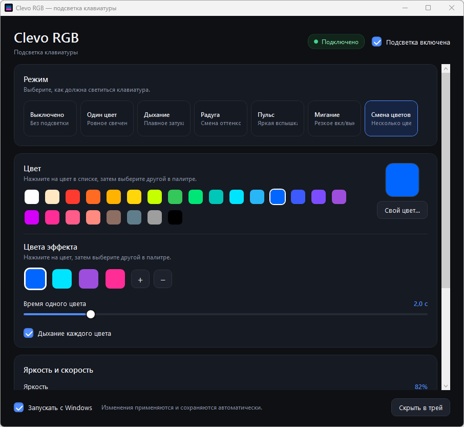
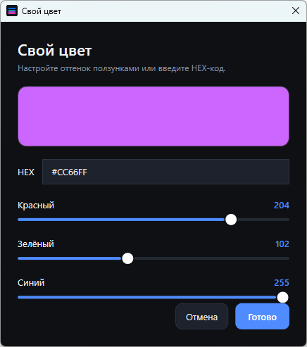

# Clevo RGB

[English](README.md) · **Русский**

Небольшая программа с открытым кодом для подсветки клавиатуры на ноутбуках Clevo / Thunderobot.

[](https://github.com/volodivianix09/clevo-rgb/releases)
[](https://dotnet.microsoft.com/)
[](LICENSE)



В Control Center от производителя есть несколько готовых цветов и ползунок яркости. Здесь — вся палитра и эффекты с настоящими плавными переходами: дыхание, радуга, пульс, мигание и смена нескольких цветов.

Без прав администратора. Без службы Windows. Без телеметрии. Без обращений в интернет.

## Зачем это нужно

На многих ноутбуках Clevo подсветкой управляет `InsydeDCHU.dll` из Control Center. Контроллер принимает только один статичный цвет, поэтому всю анимацию приходится делать программно. Программа примерно 25 раз в секунду отправляет новый цвет — так на «статичном» контроллере получаются плавные переходы.

Поэтому здесь можно то, чего нет в фирменной утилите: свои последовательности, длинные затухания, регулируемая скорость дыхания и любой цвет.

## Возможности

- **7 режимов:** Выключено, Один цвет, Дыхание, Радуга, Пульс, Мигание, Смена цветов
- **Палитра из 24 цветов** и свой цвет: ползунки RGB + HEX
- **Редактор последовательности** — до 6 цветов, настраиваемое время и дыхание каждого цвета
- **Яркость и скорость**
- **Мгновенное применение** — настройки сохраняются автоматически
- **Работа в трее** — закрыли окно, подсветка продолжает работать
- **Автозапуск с Windows** — одна галочка
- **Один экземпляр** — повторный запуск открывает уже работающее окно
- **Без администратора** и **без службы**
- **Русский интерфейс**

## На каких ноутбуках работает

> **Важно:** программа управляет **одной зоной подсветки**. Все клавиши светятся одним цветом и с одной яркостью одновременно. Per-key RGB, 3-зонные клавиатуры и отдельные lightbar используют другие контроллеры — они не поддерживаются.

| Ноутбук / платформа | Статус | Комментарий |
|---|---|---|
| **THUNDEROBOT 911 Plus** (Clevo **NH79HX-H**, i5-11400H, Windows 11) | ✅ **Проверено** | На этом ноутбуке проект разработан и протестирован |
| Clevo **NH79HX / NH7xHX** | 🟡 Скорее всего | Та же связка Control Center 3.0 / DCHU; нужно проверить |
| Clevo **P955ET1** и похожие однозонные модели | 🟡 Скорее всего | Тот же протокол `InsydeDCHU.dll` |
| Tongfang / другие сборки Clevo с тем же драйвером DCHU | 🟡 Скорее всего | Проверьте по инструкции ниже |
| Per-key RGB, 3 зоны, только lightbar | ❌ Не поддерживается | Другой протокол и контроллер |
| Lenovo, ASUS, Acer, HP, MSI, Dell и т. д. | ❌ Не поддерживается | Другой EC / SDK производителя |

**Быстрая проверка совместимости.** Откройте PowerShell и выполните:

```powershell
Test-Path "${env:ProgramFiles(x86)}\ControlCenter\DCHU\InsydeDCHU.dll"
```

Если команда вернула `True` — шанс хороший. Запустите программу и посмотрите на статус в правом верхнем углу: **«Подключено»** означает, что драйвер найден и первая запись цвета прошла успешно.

Подробнее: [docs/SUPPORTED-LAPTOPS.md](docs/SUPPORTED-LAPTOPS.md)

## Установка

### Готовая сборка

1. Скачайте `ClevoRGB-1.0.0-win-x64.zip` в разделе [Releases](https://github.com/volodivianix09/clevo-rgb/releases).
2. Распакуйте в любую папку — установщик не нужен.
3. Запустите `ClevoRgbLite.exe`.

Что нужно:

- Windows 10 или 11, x64
- **Установленный Control Center 3.0** (из него берётся `InsydeDCHU.dll`) либо этот DLL рядом с `ClevoRgbLite.exe`

Фирменный DLL **не входит** в репозиторий и в архив релиза — это проприетарный файл Clevo/Insyde. Программа ищет его по порядку:

1. Рядом с `ClevoRgbLite.exe`
2. `C:\Program Files (x86)\ControlCenter\DCHU\InsydeDCHU.dll`
3. `C:\Program Files\ControlCenter\DCHU\InsydeDCHU.dll`

SmartScreen может предупредить, что файл без цифровой подписи. Нажмите **«Подробнее» → «Выполнить в любом случае»** или соберите программу из исходников.

### Сборка из исходников

Нужен [.NET 8 SDK](https://dotnet.microsoft.com/download/dotnet/8.0).

```powershell
git clone https://github.com/volodivianix09/clevo-rgb.git
cd clevo-rgb
dotnet build ClevoRgbLite.csproj -c Release
```

Самодостаточная сборка, которой не нужен установленный .NET Runtime:

```powershell
dotnet publish ClevoRgbLite.csproj -c Release -r win-x64 --self-contained true -o publish
```

Если у вас есть локальная копия `InsydeDCHU.dll`, положите её в `lib\` перед сборкой или рядом с готовым `.exe`. В репозитории фирменных DLL нет.

## Как пользоваться

- **Режим** — выберите один из семи режимов сверху.
- **Цвет** — нажмите цвет в палитре или откройте **«Свой цвет…»** и задайте RGB/HEX.
- **Смена цветов** — выберите цветной кружок, затем нажмите цвет в палитре, чтобы заменить его. Кнопки `+` / `−` меняют количество цветов. Ползунок задаёт время одного цвета; галочка **«Дыхание каждого цвета»** включает плавное разгорание и затухание.
- **Яркость и скорость** — настраиваются сразу.
- **Крестик** — сворачивает программу в трей, подсветка остаётся.
- **Меню в трее** — открыть настройки или выйти полностью.
- **«Запускать с Windows»** — автозапуск для текущего пользователя.



Настройки:

```text
%LOCALAPPDATA%\ClevoRGBLite\settings.json
```

Журнал:

```text
%LOCALAPPDATA%\ClevoRGBLite\app.log
```

## Как это работает

Программа вызывает экспорт из фирменного DLL:

```c
int SetDCHU_Data(int command, byte[] buffer, int length);
```

с командой `0x67` и 4-байтным буфером. Цвет упаковывается как `(B << 16) | (R << 8) | G`, записываются три слота подряд, последняя запись переключает контроллер в режим статичного цвета.

Технические детали: [docs/PROTOCOL.md](docs/PROTOCOL.md).

## Если что-то не работает

**Статус «Драйвер не найден».**
Установите Control Center 3.0 или положите `InsydeDCHU.dll` рядом с `ClevoRgbLite.exe`. Нужен именно 64-битный DLL из этой же установки Control Center.

**Статус «Подключено», но клавиатура не меняется.**
Возможно, подсветку перехватила другая утилита или Fn-горячая клавиша. Смените режим или цвет в Clevo RGB ещё раз либо перезапустите программу. Control Center должен быть установлен, но работать ему не обязательно.

**У клавиатуры 3 зоны или подсветка каждой клавиши.**
Эта программа только для однозонных контроллеров. Отдельные клавиши и зоны она не адресует.

**SmartScreen или антивирус ругается.**
У исполняемого файла нет цифровой подписи. Можно собрать из исходников или разрешить запуск вручную.

**Программа нагружает процессор.**
Для анимации нужно отправлять новый цвет примерно 25 раз в секунду. На тестовом ноутбуке это около 20% одного ядра. В статичном режиме нагрузка почти нулевая.

## Донаты

Если программа пригодилась — можно поддержать разработку. Только крипта, без подписок и личных данных.

| Сеть | Адрес |
|---|---|
| **TON** (Toncoin) | `UQCZxXi57vb6twTK51lxrACf783pVJ-7wCVKG-IAYiy3H9Gq` |
| **Ethereum** (ERC-20 / EVM) | `0xeE9D7e6aD955F3EF79B257C75EcAB50cd832f5B6` |
| **Solana** (SPL) | `7PAXwGb92yhSvFCUriABuMgZ8seu6PNzSH93cSD8nowZ` |

> Отправляйте только в правильной сети. Я никогда не попрошу seed-фразу и не напишу первым с просьбой о деньгах.

⭐ Звезда на GitHub тоже помогает: по ней проект легче находят другие владельцы Clevo.

## Участие

Issues и pull requests приветствуются. Если ноутбук заработал, напишите issue с:

- точной моделью и названием barebone
- версией Windows
- скриншотом статуса программы
- нужными строками из `%LOCALAPPDATA%\ClevoRGBLite\app.log`

Пожалуйста, не коммитьте `InsydeDCHU.dll` и другие фирменные бинарники — их нельзя распространять.

## Лицензия

MIT — см. [LICENSE](LICENSE).

Clevo RGB не связана с Clevo, Thunderobot, Insyde, Intel или Microsoft. `InsydeDCHU.dll` — фирменное ПО и не распространяется вместе с проектом.
